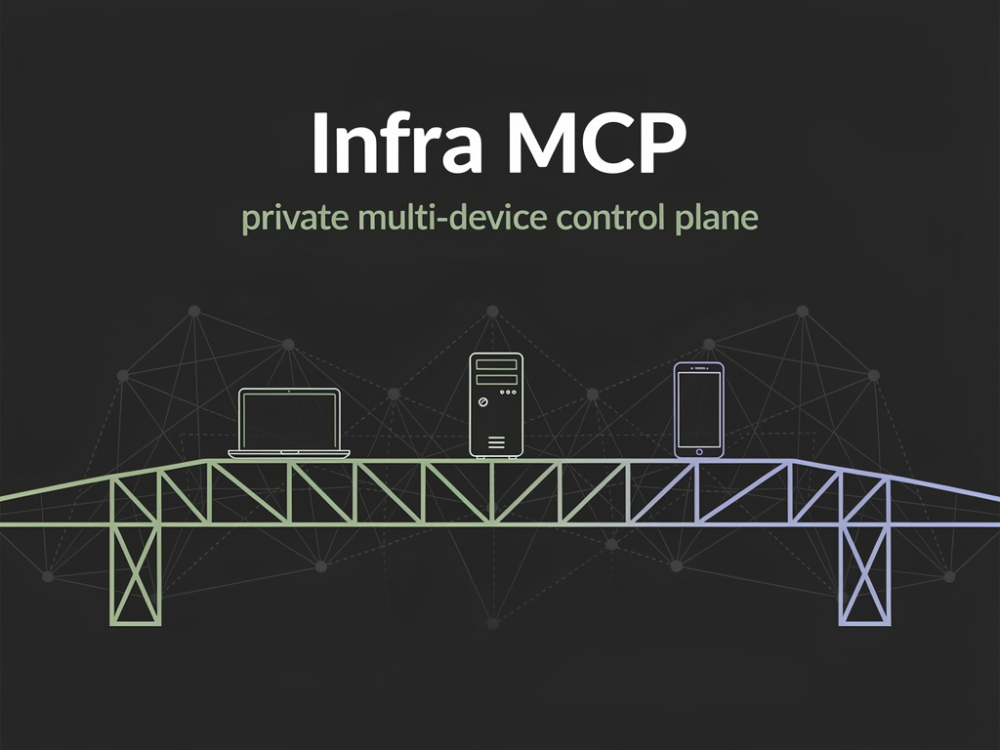
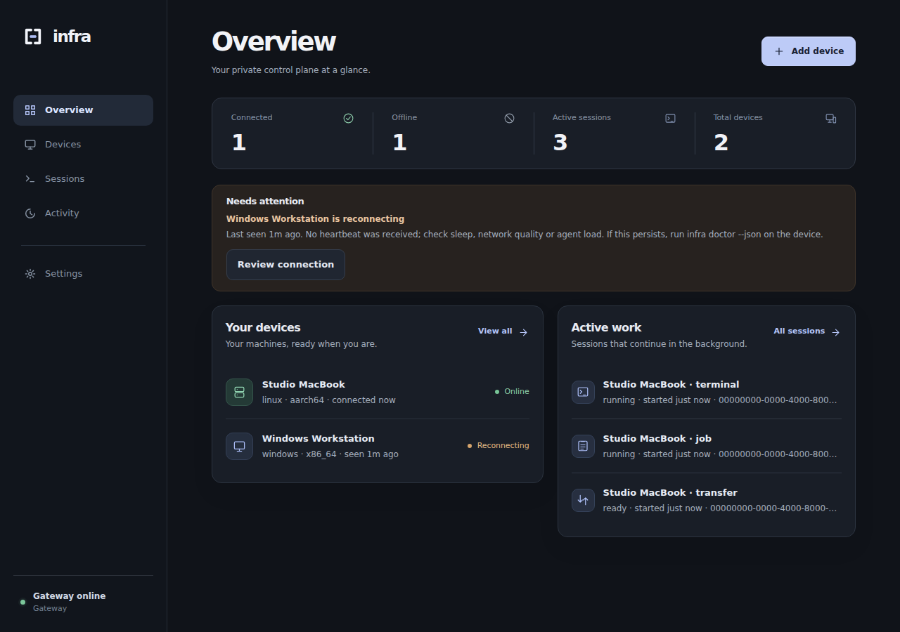
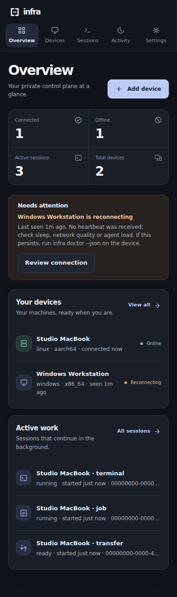

# Infra MCP

<div align="center">



One Rust gateway, signed native agents on every desktop OS, an embedded dashboard, and MCP-native tools whose terminals, jobs and transfers survive disconnects.


</div>



> Screenshots use fixture data, not live devices. The mobile layout:

<p align="center">
  
</p>

---

## Why Infra MCP

Most "AI runs your computer" setups are an SSH wrapper around a single machine. Infra MCP is a **control plane**: one gateway you own, many devices that dial out to it, and a compact set of typed MCP tools designed for models instead of humans typing shell commands.

- **Native and lightweight.** Gateway, agent and CLI are Rust binaries. No Node.js runtime on your devices.
- **Device-initiated connections.** Agents connect outbound over WSS; your machines never open an inbound port.
- **Signed identities.** Every device owns a local Ed25519 key, enrolls through a one-time owner-approved code, and re-authenticates with a fresh challenge-response on every connection.
- **Persistent work.** PTY sessions, background jobs and resumable file transfers live in durable worker processes and reconcile after reconnects, so a dropped link does not kill your work.
- **Bounded and auditable.** Operations have explicit limits, explicit `outcome_unknown` states instead of unsafe replays, and a durable audit trail that never records secrets or file contents.
- **Multi-device by design.** One client connection addresses a fleet: your Mac, Windows box, Linux server and Android phone behind the same gateway.

## Architecture

```text
                         AI client
                     (ChatGPT, MCP app)
                            |
                     MCP Streamable HTTP
                            v
                  +---------------------+
                  |    infra-gateway    |
                  |     Rust, SQLite    |
                  |  auth, sessions,   |
                  |  dispatch, audit    |
                  +----------+----------+
                             |
                  persistent agent transport
                  (outbound WSS, reconnect,
                   generation supersession)
                             |
          +------------------+------------------+------------------+
          |                  |                  |                  |
          v                  v                  v                  v
   +-------------+    +-------------+    +-------------+    +-------------+
   | macOS agent |    |Windows agent|    | Linux agent |    |Android agent|
   |    Rust     |    |    Rust     |    |    Rust     |    | Infra Phone |
   +------+------+    +------+------+    +------+------+    +-------------+
          |                  |                  |
        optional           optional           optional
   privileged helper   privileged helper   privileged helper
```

The gateway is the only component that needs to be reachable; everything else dials home. Each agent runs as the signed-in user, keeps its private key in the OS credential store, and reports capabilities so the gateway can route requests to devices that actually support them.

## MCP tool surface

Compact tool families instead of dozens of micro-tools:

| Family | What it does |
| --- | --- |
| `devices` | Fleet listing, per-device status and capabilities |
| `exec` | Bounded one-shot command execution |
| `jobs` | Durable background jobs: start, read output, wait, cancel |
| `terminal` | Persistent PTY/ConPTY sessions with transcript reads |
| `files` | Read, write, append, exact edit, list, stat, hash, move |
| `search` | Regex/literal file and content search with gitignore awareness |
| `transfer` | Resumable, SHA-256-verified binary upload/download |
| `processes` | Process listing and direct tree termination |
| `system` | CPU, memory, load, disks, network interfaces |
| `network` | DNS resolution, TCP checks, listener enumeration |
| `services` | systemd / launchd / Windows SCM status and control |
| `containers` | Docker list, inspect, logs, start/stop/restart |
| `git` | Status, diff, log, branches, fetch, pull, push |
| `desktop` | Screen capture and desktop automation actions |

Per-action schemas and retry semantics: [docs/AGENT_CLIENT_GUIDE.md](docs/AGENT_CLIENT_GUIDE.md).

## The dashboard

The gateway embeds a dependency-free dark dashboard: Overview, Devices, Sessions, Activity and Settings, owner-approved device enrollment with generated per-OS bootstrap commands, live state over server-sent events, an attachable browser terminal, and bounded file browsing. Owner sign-in uses an Argon2id password with a rotating HMAC session cookie; the dashboard never touches `localStorage` with credentials.

Design and implementation history: [docs/DASHBOARD.md](docs/DASHBOARD.md).

## Getting started

> Infra v1 is in **release-candidate** stage (`v0.1.1-rc.x`). Binaries are functional and signed with the release publisher key, but this is not yet a recommended production installation. Read [docs/RELEASE_CANDIDATE.md](docs/RELEASE_CANDIDATE.md) for current acceptance limits.

### 1. Run a gateway

Build and run the gateway on a host you control (any Linux/macOS/Windows box; a small VPS or home server is fine):

```sh
git clone https://github.com/Phloraxx/infra-mcp.git
cd infra-mcp
cargo build --release -p infra-gateway
```

The gateway serves MCP and the dashboard over HTTP(S). Put TLS in front before exposing anything; see [docs/DEPLOYMENT.md](docs/DEPLOYMENT.md) and [docs/SECURITY_MODEL.md](docs/SECURITY_MODEL.md).

### 2. Enroll a device

On each device, download the installer, read it, then run it and approve the pairing code in the dashboard:

```sh
curl -fsSL -o install.sh https://raw.githubusercontent.com/Phloraxx/infra-mcp/main/scripts/install.sh
less install.sh                      # review what it does
sh install.sh --gateway wss://your-gateway/agent
```

```powershell
Invoke-WebRequest -OutFile install.ps1 https://raw.githubusercontent.com/Phloraxx/infra-mcp/main/scripts/install.ps1
Get-Content install.ps1 | Out-Host   # review what it does
.install.ps1 -Gateway wss://your-gateway/agent
```

Release mode verifies SHA-256 sidecars before installing binaries. The installer registers a per-user startup entry (systemd user unit, LaunchAgent, or Windows Scheduled Task), and `infra status` / `infra doctor` / `infra repair` keep the setup healthy.

For the full pairing and recovery design: [docs/ONE_COMMAND_SETUP.md](docs/ONE_COMMAND_SETUP.md), [docs/INSTALLATION_UX.md](docs/INSTALLATION_UX.md).

### 3. Connect an MCP client

Point your MCP client at the gateway's MCP endpoint (Streamable HTTP) and select a device in your prompts. End-to-end check:

```sh
scripts/smoke-v1.sh                  # signed enrollment, exec, reconnect
scripts/smoke-install-dashboard.sh   # installer + dashboard + sessions
```

## Android companion — Infra Phone

`apps/android-agent` is a first-class Android client (**Infra Phone**) enrolled over the same signed gateway: scoped files, SHA-256-checked transfers, owner-reviewed APK installs, and a service that reconnects like the desktop agents. Current validated capabilities, safety constraints and open reliability tests: [docs/ANDROID_CURRENT_STATUS.md](docs/ANDROID_CURRENT_STATUS.md).

## Security

- Per-device Ed25519 keys never leave the device; fresh challenge-response on every connection; captured signatures are bound to a single connection.
- One-time enrollment codes are random, short-lived, hashed at rest, single-use and owner-approved.
- Audit records store action, outcome and request IDs, never stdout, secrets or file contents.
- Escalated operations are planned as a separate optional privileged helper; agents run as the signed-in user.
- Releases ship a signed Ed25519 manifest and SHA-256 sidecars; the updater refuses unverified artifacts.

Full model: [docs/SECURITY_MODEL.md](docs/SECURITY_MODEL.md) · reporting: [SECURITY.md](SECURITY.md) · release trust: [docs/RELEASE_SIGNING.md](docs/RELEASE_SIGNING.md), [docs/RELEASE_PUBLISHER_KEY.md](docs/RELEASE_PUBLISHER_KEY.md).

## Repository layout

```text
infra-mcp/
├── crates/
│   ├── protocol/      # versioned wire types shared by gateway and agents
│   ├── gateway/       # MCP server, broker, SQLite state, audit, dashboard
│   ├── agent/         # headless cross-platform device agent
│   ├── platform/      # per-OS abstractions (PTY, services, credential store)
│   ├── local-state/   # atomic local config/runtime/proof state
│   └── cli/           # the `infra` CLI (status, doctor, install, repair)
├── apps/
│   ├── dashboard/     # embedded web dashboard (HTML/CSS/JS, no build step)
│   └── android-agent/ # Infra Phone Android app
├── scripts/           # installers, smoke tests, release signing/contract
└── docs/              # design and status documents
```

## Documentation

| Topic | Document |
| --- | --- |
| Product spec | [docs/PRODUCT_SPEC.md](docs/PRODUCT_SPEC.md) |
| Architecture | [docs/ARCHITECTURE.md](docs/ARCHITECTURE.md) |
| Wire protocol | [docs/PROTOCOL.md](docs/PROTOCOL.md) |
| Tool contracts | [docs/AGENT_CLIENT_GUIDE.md](docs/AGENT_CLIENT_GUIDE.md) |
| Security model | [docs/SECURITY_MODEL.md](docs/SECURITY_MODEL.md) |
| Dashboard design | [docs/DASHBOARD.md](docs/DASHBOARD.md) |
| Installation UX | [docs/ONE_COMMAND_SETUP.md](docs/ONE_COMMAND_SETUP.md) |
| Android agent | [docs/ANDROID_CURRENT_STATUS.md](docs/ANDROID_CURRENT_STATUS.md) |
| Implementation status | [docs/IMPLEMENTATION_STATUS.md](docs/IMPLEMENTATION_STATUS.md) |
| Decisions | [docs/DECISIONS.md](docs/DECISIONS.md) |
| Roadmap | [docs/ROADMAP.md](docs/ROADMAP.md) |
| Deployment | [docs/DEPLOYMENT.md](docs/DEPLOYMENT.md) |

## Development

```sh
cargo fmt --all
cargo clippy --workspace --all-targets -- -D warnings
cargo test --workspace
```

CI runs the full matrix on Ubuntu, macOS and Windows (x64 + ARM64), an Android job for the companion app, a headless browser suite for the dashboard, and release contract/signing checks. Design principles and workflow notes: [AGENTS.md](AGENTS.md), [docs/DEVELOPMENT.md](docs/DEVELOPMENT.md).

## Status and roadmap

The Rust control plane is feature-complete for day-to-day remote operation and running live burn-in validation. Active areas: publisher-authenticated first-install trust, physical Windows login/reboot/rollback validation, public OAuth for MCP clients, and long-term soak testing. Current snapshot: [docs/CURRENT_REALITY.md](docs/CURRENT_REALITY.md), next steps: [docs/NEXT_STEPS.md](docs/NEXT_STEPS.md).

## License

[MIT](LICENSE) © 2026 Sourav P Bijoy
