# Dashboard product design

The dashboard is a control/status surface, not a replacement for ChatGPT. It should make setup, health, recovery, permissions, sessions, and audit history obvious while keeping routine operation minimal.

## Information architecture

Keep the global navigation small:

1. **Overview**
2. **Devices**
3. **Sessions**
4. **Activity**
5. **Settings**

The primary CTA is **Add device**.

## Overview

The home screen should answer three questions immediately:

- Are my devices reachable?
- Is anything requiring attention?
- What is currently running?

Recommended sections:

### Device summary

Compact cards/rows showing:

- friendly device name
- OS/icon and architecture
- connection state
- last seen when not connected
- agent version/update state
- key capabilities (Shell, Files, Desktop, Elevated)
- active session/job count

Do not overload cards with CPU charts and detailed telemetry unless there is an actionable reason.

### Needs attention

Only show this section when relevant. Examples:

- Accessibility permission missing
- agent outdated
- startup integration broken
- repeated reconnect failures
- privileged helper unhealthy
- credential/key-store problem

Each item should have one primary corrective action.

### Active work

Show running PTYs, jobs, and transfers across all devices with attach/cancel controls.

## Device detail page

Tabs:

### Overview

- connection status and quality
- hostname/friendly name
- OS/version/architecture
- uptime and current boot ID
- agent/gateway compatibility
- install/startup mode
- capabilities and permissions
- last successful heartbeat
- optional concise system health

Primary actions: `Reconnect`, `Run doctor`, `Update`, `Remove`.

### Terminal

A human terminal is useful for diagnostics and testing, but not the primary product. It should attach to the same persistent PTY system used by MCP.

### Files

Simple browse/download/upload capability. Avoid building a full IDE.

### Sessions

List persistent PTYs, jobs and transfers with state, start time, owner/request origin, retained output size, and controls.

### Permissions

Show capability-by-capability status:

- shell/files
- screen capture
- accessibility/input automation
- clipboard
- privileged helper

For OS permissions, show the exact local action needed and detect when permission changes.

### Diagnostics

Human-readable `doctor` output, recent reconnect history, version details, startup registration state, and exportable sanitized diagnostics.

### Activity

Device-scoped audit history.

## Sessions page

Global view of:

- interactive terminals
- background jobs
- file transfers

Filters by device/state/type. Sessions should remain discoverable after ChatGPT/browser refresh.

## Activity page

Searchable timeline containing bounded metadata:

- timestamp
- device
- action/tool family
- status
- duration
- request/session ID
- initiator/client

Do not store command stdout, arbitrary file contents, secrets, or clipboard contents in the audit database by default.

## Settings

Keep settings focused:

- gateway/public endpoint status
- connected ChatGPT/MCP clients
- device enrollment policy
- update channel
- retention limits
- security/audit options
- advanced transport settings hidden behind an Advanced section

## Visual behavior

Use a restrained, utility-first interface. Avoid decorative dashboards, fake charts, excessive gradients, and dense card grids.

Status indicators must not depend on color alone; pair color with text/iconography.

Use progressive disclosure: advanced networking/protocol details belong in diagnostics, not the Overview page.

## Real-time updates

The dashboard should update device state, enrollment progress, active sessions, and repair/update progress without manual refresh, using a server-sent or WebSocket event channel.

The gateway no longer retires an agent at the first missed pong window: the heartbeat deadline now tolerates stalls up to 90 seconds (override with INFRA_HEARTBEAT_TIMEOUT_SECS, floor 30s), so laptop sleep transitions and brief Wi-Fi/Tailscale hiccups no longer flap a device offline that would have recovered on its own.

## Mobile behavior

Mobile dashboard should support monitoring, approving enrollment, reconnect/repair/update actions, session inspection, and basic terminal attachment. File management and advanced diagnostics can remain desktop-optimized.

## Destructive actions

Removing/revoking a device, killing a session, uninstalling remotely, or performing privileged destructive actions must clearly identify the target device and consequence before execution.
## Implemented foundation — 2026-10-15

The gateway now embeds a dependency-free dashboard under `/` with Overview, Devices, Sessions, Activity and Settings, responsive/dark-mode styling, Add Device enrollment and OS-specific bootstrap commands. Private-mode browser authentication exchanges the admin credential once for a 12-hour HMAC-signed `HttpOnly; SameSite=Strict` session cookie; the credential input is cleared and no admin secret is retained in `sessionStorage`/`localStorage`. `/api/events` uses the same authenticated browser cookie and server-sent events to refresh state immediately, with periodic polling as fallback.

The dashboard is backed by persisted `/api/devices`, reconciled `/api/sessions`, and bounded `/api/activity` metadata. The activity store records action family, outcome, request ID, timestamp and device association; it intentionally does not persist command output, arbitrary file contents or enrollment/private-key material.

This is the control/status foundation, not the finished dashboard. Device-detail actions, human terminal attachment, file browser/transfer controls, permission onboarding, doctor/repair UI, update progress, standards-compatible public OAuth and richer attention states remain. Private-mode bearer/cookie authentication is implemented; Internet-facing deployment still requires the final OAuth/TLS edge rather than treating the admin credential as a public identity system.

## Device and session controls — 2026-10-16

The dashboard now includes addressable device detail views (Overview, Terminal,
Files, Sessions and Activity). Device status, version, capabilities, last seen and
active-work counts use the existing registry. Check agent sends a real status RPC;
it is a connectivity check, not a substitute for local `infra doctor`.

The browser terminal uses a locally bundled, MIT-licensed xterm.js 5.5.0 renderer.
It opens and attaches to the same durable PTY IDs that MCP uses, with incremental
32 KB transcript reads, serialized/batched input, resize, Ctrl+C and explicit close.
Leaving the page detaches the viewer. Refreshing a session URL reattaches to that
ID; it never opens a replacement terminal. Lost/ambiguous writes pause input and
require an explicit Resume connection action; they are never automatically replayed.
Terminal history expiry is reported. Job output is bounded in the browser, and jobs
and transfers have explicit cancellation controls naming the device and session.

Sessions can be filtered by device and type. Files supports directory browsing,
parent navigation and bounded UTF-8 preview with byte ranges/next-chunk controls.
File and terminal text are rendered as text, not injected as HTML. Sign-out clears
private views; offline/revoked devices cannot receive browser actions.

`POST /api/devices/{device_id}/operations` is inside the existing bearer/signed
cookie + CSRF boundary. It accepts only the currently supported status, terminal,
job list/read/cancel, file list/read/stat/hash and transfer list/status/cancel
operations, and shares MCP's dispatcher/audit path. Responses use `no-store`.
The static CSP allows inline **styles** for xterm's generated grid, while scripts
remain self-only and inline scripts/remote assets remain blocked.

Remaining dashboard work: file upload/download and mutation UX, full doctor/repair
and sanitized export, permission onboarding, updater/rollback views, richer session
metadata/history, automatic terminal fitting, and broader real-device/mobile
acceptance. The current checks do not claim those features are implemented.

## Password sign-in and branding — 2026-10-16

A dedicated sign-in screen now owns the unauthenticated/loading state. The app
shell stays hidden until authentication succeeds; a signed-out browser no longer
shows a misleading zero-device dashboard. Initial data loading starts after the
session check, and logout/session expiry closes SSE and clears private views.

Owner mode is configured with `INFRA_DASHBOARD_AUTH_FILE`. The login uses username
and password, an Argon2id hash, a separate random browser signing secret, bounded
verification concurrency and a global 12-attempt/minute limit. Settings supports
password changes after verifying the current password. Changes atomically update
the private auth file and rotate the signing secret, invalidating older browser
sessions. Browser credentials are never saved in Web Storage or returned by APIs.

The gateway serves locally bundled image assets for the logo, PNG/ICO favicons and
touch icon. The monochrome mark appears on sign-in and in the sidebar, with a
dark-mode treatment. See `apps/dashboard/assets/README.md` for its generation brief.

The HTTPS dashboard hostname is routed through Cloudflare Tunnel to the private
origin. The public hostname redirects HTTP reads to HTTPS, rejects cross-origin
requests, and does not expose `/mcp`; that endpoint remains private pending OAuth.
Agent challenge authentication and one-time enrollment keep their separate trust
boundaries. No public inbound host port is added.

## Visual evolution — 2026-10-24

The former per-redesign documents (DASHBOARD_REDESIGN.md, DASHBOARD_STUDIO.md, DASHBOARD_QUIET.md and DASHBOARD_DARK.md) are consolidated into this section.

Four visual revisions shipped on October 24, 2026, ending with the current **Quiet Dark edition**. Every step kept the same backend contract, browser interaction-safety checks and CSP, and introduced no new dependencies or third-party assets. Each production rollout was guarded: fresh SQLite snapshot, staging validation against the live schema, no active remote work, signed-device reconnection acceptance, and a preserved rollback binary and audit log.

### Infra Fieldwork — personal operations workspace

The generic SaaS card stack was replaced with a quiet, technical, tactile workspace: forest/charcoal navigation, warm mineral surfaces, citron connection signals, editorial typography and fine-lined network geometry.

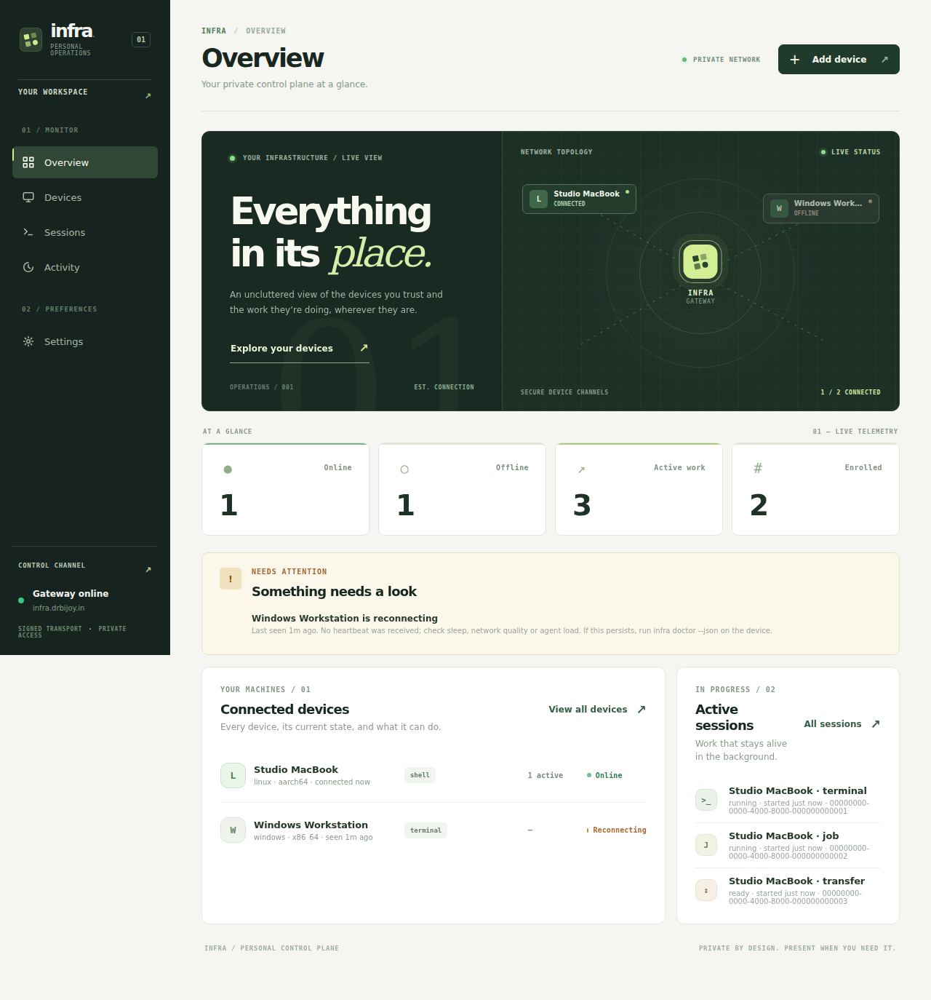

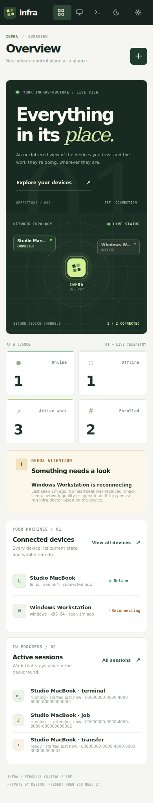

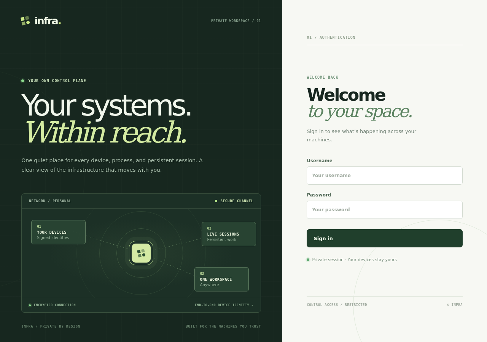

Design highlights: real device topology (up to four signed devices with online/offline state and the exact fleet-wide connected count, opening devices by stable ID, no fabricated telemetry); overview hierarchy of operations hero, four live measures, offline attention, device inventory and persistent sessions; inventory search with a slash shortcut outside editable or terminal contexts; authenticated owner pairing with local comparison code alongside legacy enrollment; escaped server-provided labels; no third-party font/script/image CDNs; responsive verification at 320/390/768/1280 px with dark-mode and motion-reduction support. No backend stack change: the Rust gateway still embeds the dashboard assets through its existing same-origin frontend routes. Preview screenshots use fictional devices and sessions, not production data.

### Infra Studio — identity and dashboard redesign

Rebuilt in graphite and muted periwinkle: a balanced two-column device/work canvas, spacious four-figure operational summary, responsive compact navigation and an original geometric bridge logomark. The vector source lives at apps/dashboard/assets/logo.svg with matching raster wordmark, favicon and touch icons, all served locally rather than from external assets. The creative direction took design principles, not assets, from public Dribbble references.

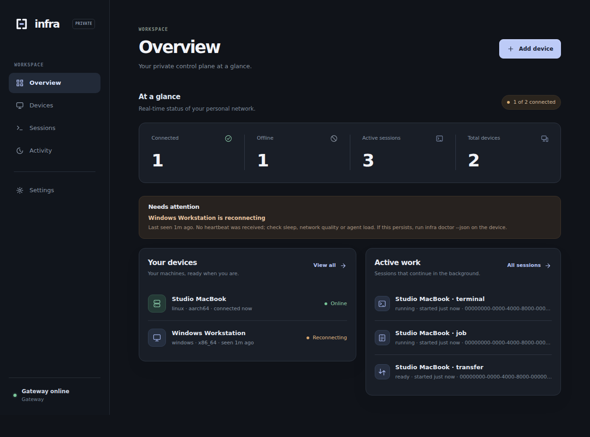

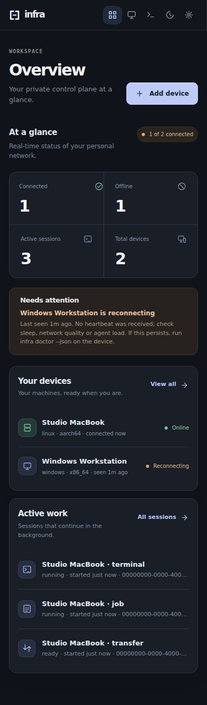

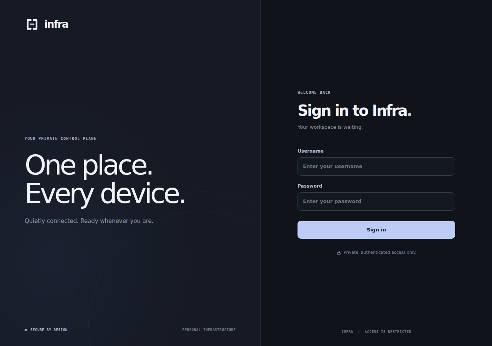

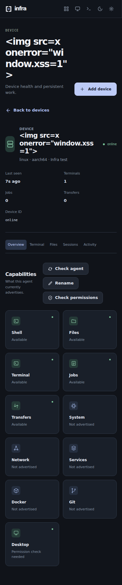

The browser suite verified the unchanged backend contract, owner pairing, terminal attach, remote operations, file browser, persistent sessions, logout, hostile-name escaping, locally loaded brand images, CSP and no overflow at 320/390/768/1280 px. The first rollout attempt was automatically rolled back when a suspended Mac transfer failed the strict preservation check; Studio was then merged with concurrent installer fixes rather than overwriting them.

### Infra Quiet — minimal list-first revision

Removed the decorative hero, topology illustration, saturated colors and stacked promotional surfaces in favor of calm whitespace, a light palette, list-first device management, compact status metrics and a single focused login form. Existing device, session, file, terminal, activity, authentication and pairing functionality remained.

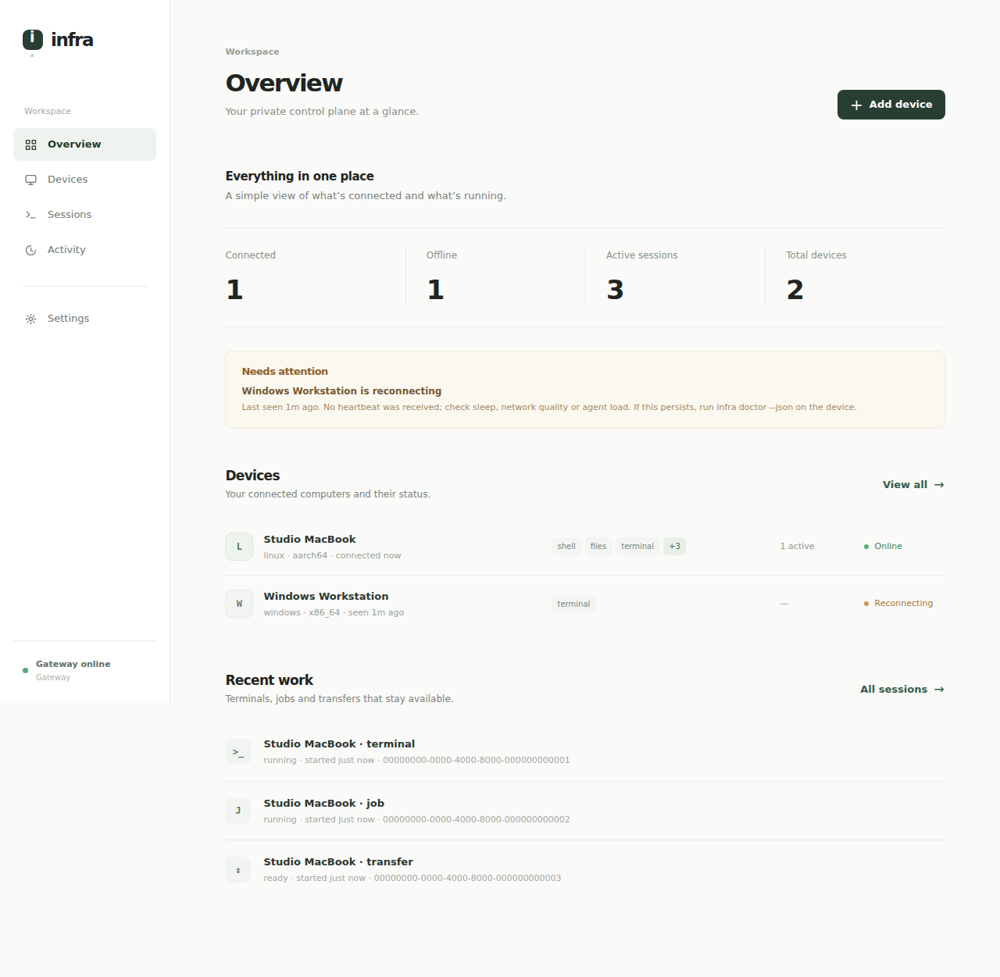

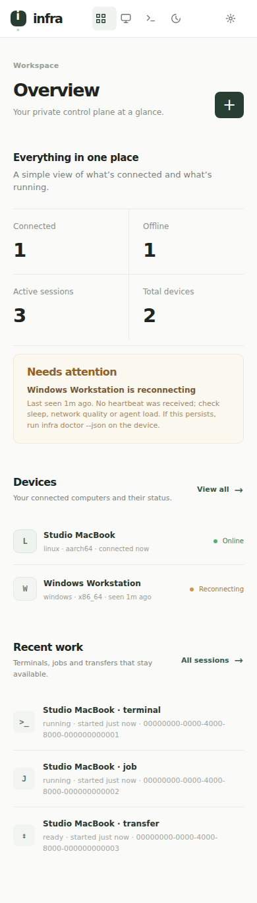

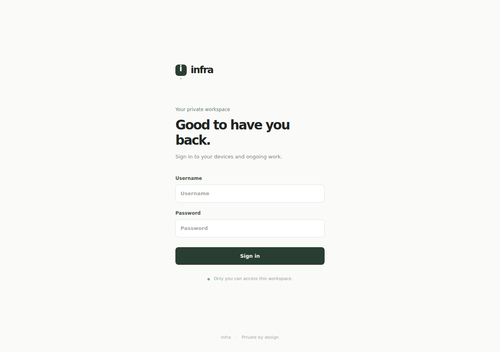

### Minimal icon system

Locally embedded SVG icons replaced placeholder letters for device platforms, sessions, capabilities, file browsing, search, metrics and common actions. No new dependencies or third-party assets; device and user labels remain escaped.

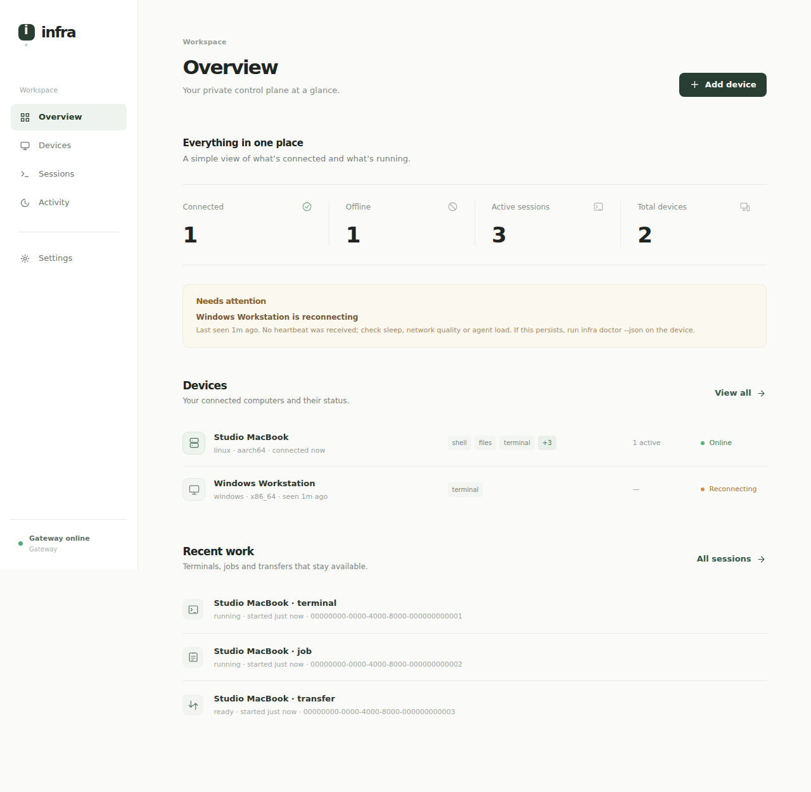

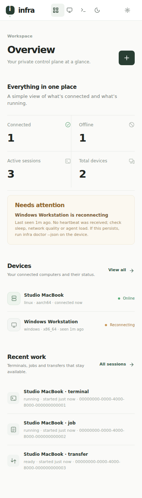

### Dark edition — v3 visual system

A dark visual system for the existing minimal, list-first dashboard. Layout, information hierarchy, device/session controls, owner pairing and authentication are unchanged. Graphite-black backgrounds (#101312), restrained raised surfaces (#181c1a / #1e2420), warm white text (#eef2ee), subdued green accents (#8fc3a0) and soft status colors across dialogs, inputs, empty states, inventory rows, files, settings, terminal and mobile navigation. The browser announces a dark color scheme regardless of OS theme preference; there is no light-mode toggle.

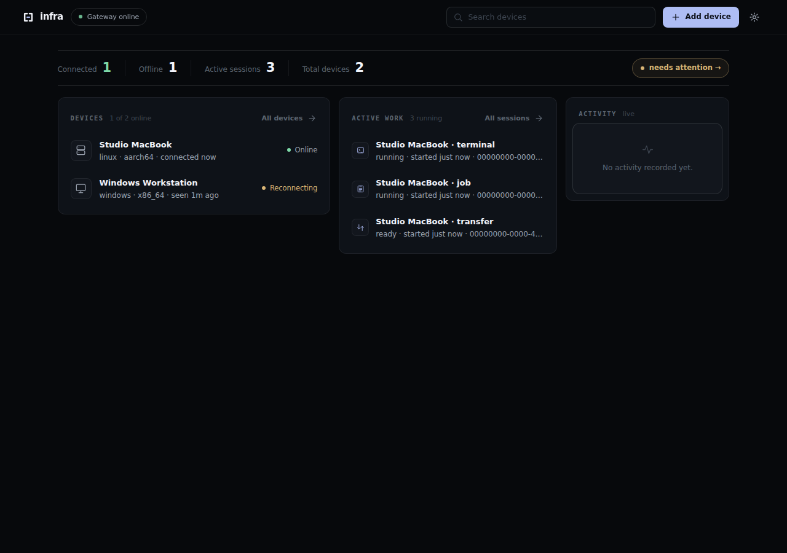

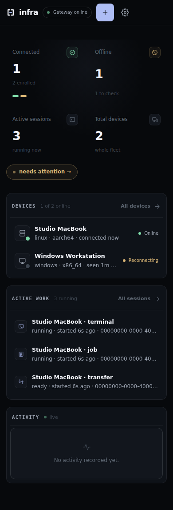

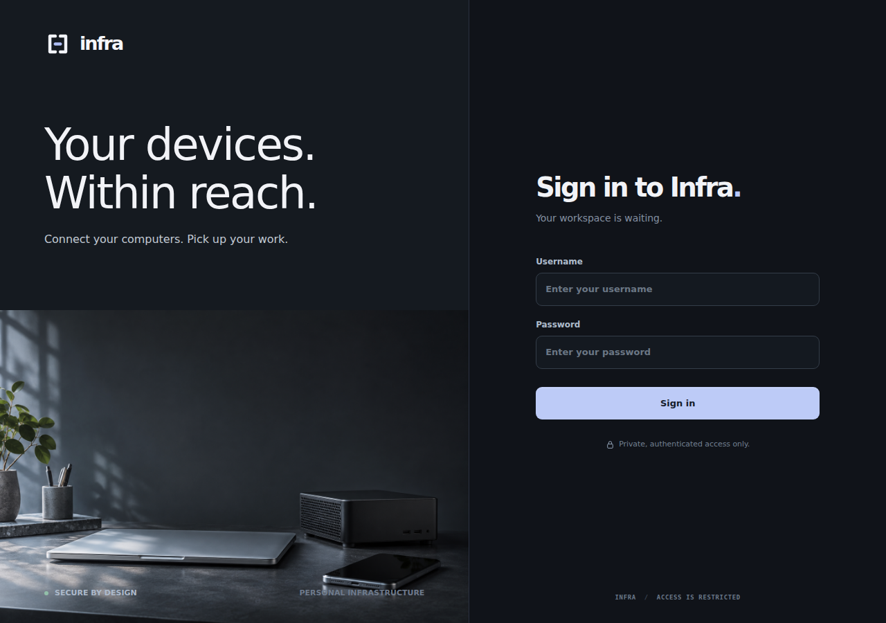

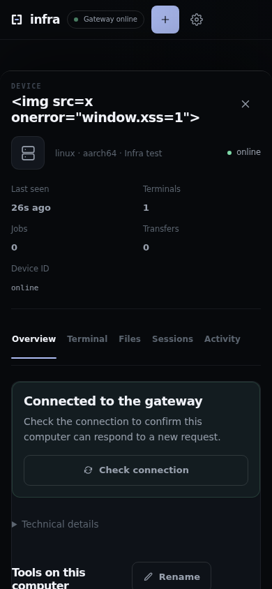

Browser regression checks cover dark login and input surfaces, the dark owner-pairing dialog, the near-black terminal, layout at 320/390/768/1280 px, dark appearance even under an OS light preference, and all existing device/session/auth/XSS interactions. Screenshots use fixture data, not private live device data. The frontend is embedded in the Rust gateway; updating the repository or releasing the CLI/agent does not automatically deploy it.

### Console edition — current layout

One screen instead of five views. The sidebar is replaced by a sticky topbar: brand, a live gateway chip, device search, Add device and a settings popover (change password, session and keys, sign out). The four summary cards collapse into one 56-px KPI line with an amber needs-attention chip that jumps straight to the offline device. Devices, active work and activity become zones on a single 5/4/3 grid. The device page becomes a 500-px drawer with the same tabs (a bottom sheet on mobile); the session page becomes a full-screen overlay; Esc closes anything. Sign-in keeps the v3 surfaces with friendlier copy: "Welcome back.", a live gateway status chip before you type, an example username placeholder, and "Just you, your keys and your machines."

The browser gate additionally covers the attention chip jumping into the drawer, the settings popover, topbar zone search and the friendlier sign-in copy. Screenshots use fixture data, not private live device data. The frontend is embedded in the Rust gateway; updating the repository or releasing the CLI/agent does not automatically deploy it.

### Console refinements — current polish

Feedback pass over the console layout, still in the v3 design language:

- The KPI line is now real stat cards: icon tile, big tabular figure and a quiet caption, with a hover lift.
- Whole rows are the click target. A device row or session row opens directly; rows are keyboard-focusable and answer Enter and Space.
- The device drawer floats in over a whisper of a scrim instead of dimming the whole screen; rounded corners, soft cast shadow, spring easing.
- Sessions and terminals open as a centred pop-up over the console instead of taking over the page. Esc, the dimmed backdrop or Close returns to the console; the interactive terminal itself keeps raw Esc for vim and shells.
- Activity entries carry a right-aligned relative time and clamp long identifiers, so nothing leaves its zone.
- The settings control is an unmistakable cog that turns on hover; its popover springs from the gear.
- Zones rise in sequence on load; motion respects prefers-reduced-motion.
- A fleet strip under the Connected card mirrors per-device presence at a glance: one segment per machine, green while connected, amber while reconnecting.
- The Activity zone header carries a breathing live dot and a recent-event count.
- Arrow keys walk device and session rows; Enter opens the focused row.
- Device rows surface recent drop context, e.g. "dropped 12m ago · heartbeat", when a machine came back within the last day.

## Deployment audit trail — infra.drbijoy.in

| Rollout | Gateway commit | Deployed gateway SHA-256 | Rollback/staging snapshot |
| --- | --- | --- | --- |
| Infra Fieldwork | 16ef052 | 6913b7c0a683c39262b6d7cebe3baf3e22c87f5551610d746faebf31f3676372 | staging-20261024-fieldwork/ |
| Infra Studio | fd91f06, then combined with installer fixes (ce6e3c3) | e59c759dce4a34608007aa3e78f5c1962bdc03ee4bad707319d4634e73303e8a | staging-infra-studio-20261024/ |
| Infra Quiet | 808666f | aa1773b0681791911e8ef9340f8c136022468a672ac20fe4fa25c1bc66f53f01 | staging-20261024-quiet/ |
| Icon system | 0756ddc | d171c4aad196c1c0dc8ff09a498751352be0f5c6870a5b6cd905359102eee6e5 | staging-20261024-icons/ |
| v3 design language | bc6ad9e | 87269c160f126e4d011bf14898adefe800f05059a2ea112aa4191ba080045624 | bin/infra-gateway-3f079f0 |
| Console edition and friendlier sign-in | 9664a40 | b9ea83d05b753de300e7155682ae71a4c3851e460fa4bc08e4a8b808b8edf814 | bin/infra-gateway-bc6ad9e |
| Console polish: stat cards, floating drawer, session pop-up | fff32be | a53f588d3660f50d1dbf0981dba1f874c36379ebe3cac3a58b9aac282bbb4da9 | bin/infra-gateway-9664a40 |
| Console v4.2: fleet strip, drop context, arrow keys; tolerant 90s heartbeat deadline | 3318a69 | 5c1f168b6f83afb9fa6254c0795a4fe2961228aa470e62a421838e04cc704963 | bin/infra-gateway-fff32be |
| Hotfix: placeholder leak in the drop-note template; QA fixture now covers the drop-context path | 60bf1d9 | 7c693470923e053fc38b984d947ee865702a12bc5adff4fe4654e6978c742a59 | bin/infra-gateway-3318a69 |

All snapshots are preserved under ~/.local/share/infra-v1-remote-burnin/gateway/. Every guarded rollout saved the previous binary and a consistent SQLite backup, verified public HTTPS assets, browser authentication, OAuth metadata, SQLite integrity (schema v5, three enrolled devices) and signed-device reconnection. The Fieldwork rollout preserved the then-uncommitted OAuth loopback callback patch without modifying the original worktree, and proved the old binary compatible with schema v5 before cutover. Native device binaries and enrolled identities were never changed by a dashboard rollout.

## Open release gates

Still outstanding, independent of the dashboard rollouts above:

- Publisher-authenticated first-install bootstrap trust.
- Physical Windows first-install/reboot/rollback validation.
- Long-term soak of the live gateway.
- Confirming the Mac's offline pending download once the Mac reconnects.

Remaining dashboard feature work: file upload/download and mutation UX, full doctor/repair and sanitized diagnostics export, permission onboarding, updater/rollback views, richer session metadata/history, automatic terminal fitting and broader real-device/mobile acceptance.
