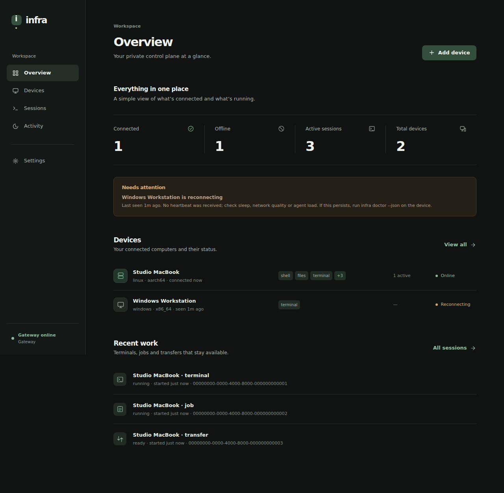
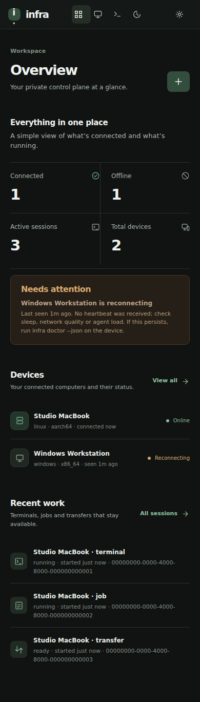
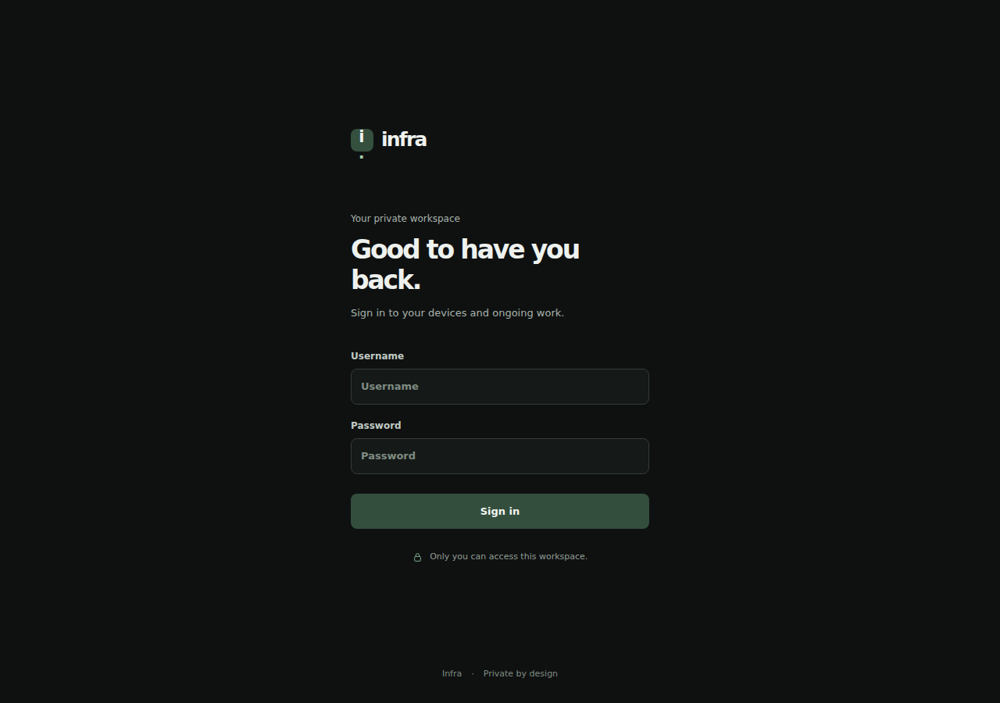
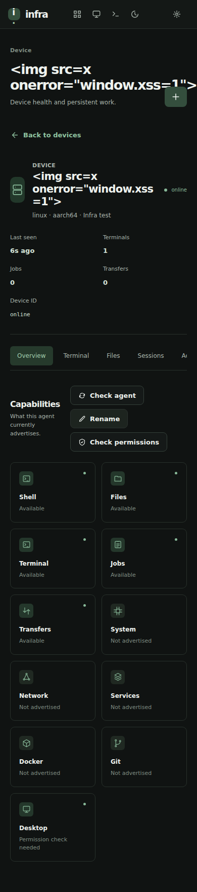

# Infra Quiet — Dark edition

A dark visual system for the existing minimal, list-first dashboard. The layout, information hierarchy, device/session controls, owner pairing and authentication remain the same.

The UI uses graphite-black backgrounds (#101312), restrained raised surfaces (#181c1a / #1e2420), warm white text (#eef2ee), subdued green accents (#8fc3a0), and soft status colors. Dialogs, inputs, empty states, inventory rows, files, settings, terminal and mobile navigation share the same scheme. The browser announces a dark color scheme regardless of operating-system theme preference; there is no light-mode toggle.

## Real Chromium renders

## Verification

Browser regression checks confirm dark login and input surfaces, dark owner-pairing dialog, near-black terminal, layout at 320/390/768/1280px, dark appearance even under an OS light preference, and all existing device/session/auth/XSS interactions. The Rust gateway test suite and strict linting pass.

These screenshots use sample fixture data, not private live device data. The actual frontend is embedded in the Rust gateway; updating GitHub or the separate CLI/agent release does not automatically deploy it.
