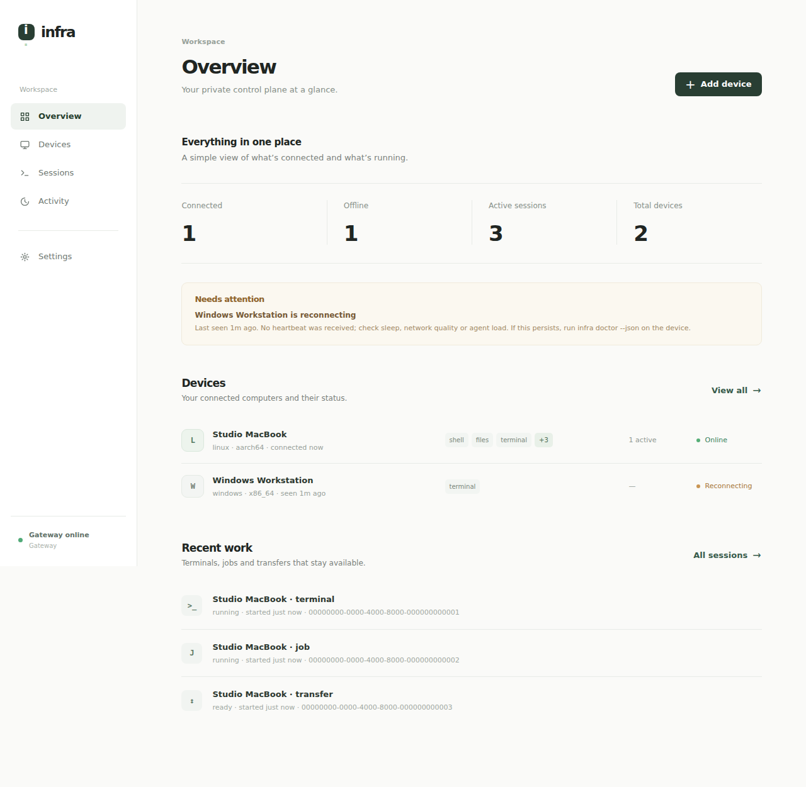
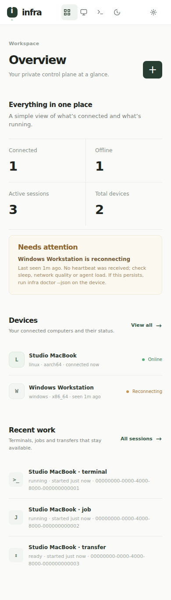
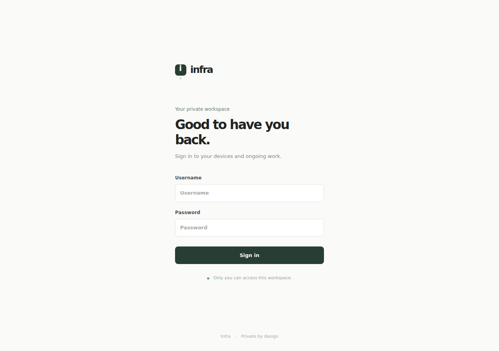
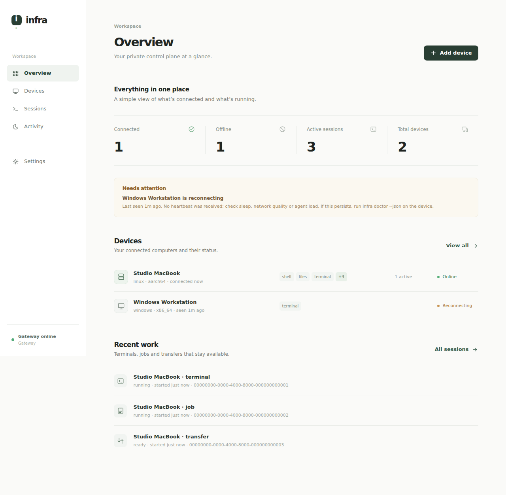
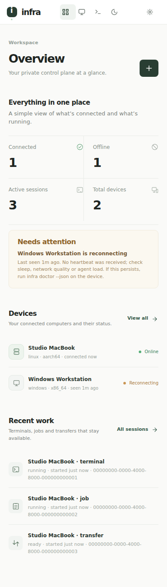

# Infra Quiet

A minimal UI revision with calm whitespace, a light palette, list-first device management, compact status metrics, and a single focused login form.

Removed the decorative hero, topology illustration, saturated colors, and stacked promotional surfaces. Existing device, session, file, terminal, activity, authentication, and pairing functionality remains.

Browser regressions cover 320 to 1280 pixel widths and existing interaction safety tests. These captures show test fixtures, not live private data.

## Live deployment — October 24, 2026

Quiet dashboard commit `808666f` was compiled into the production Rust gateway and deployed at https://infra.drbijoy.in with the existing OAuth behavior retained. Live gateway SHA-256: `aa1773b0681791911e8ef9340f8c136022468a672ac20fe4fa25c1bc66f53f01`.

The guarded rollout saved the previous binary and a consistent SQLite backup under `~/.local/share/infra-v1-remote-burnin/gateway/staging-20261024-quiet/`. It verified public HTTPS assets, browser authentication, OAuth metadata, SQLite integrity and reconnection of both previously online signed agents. Three enrolled device identities remain intact, and no active work was present at restart. The Android device was already offline. Native agent binaries were not updated.

## Minimal icon system

Locally embedded SVG icons replace placeholder letters for device platforms, sessions, capabilities, file browsing, search, metrics and common actions. No new dependencies or third-party assets. Device/user labels remain escaped. Desktop and mobile Chromium previews:

