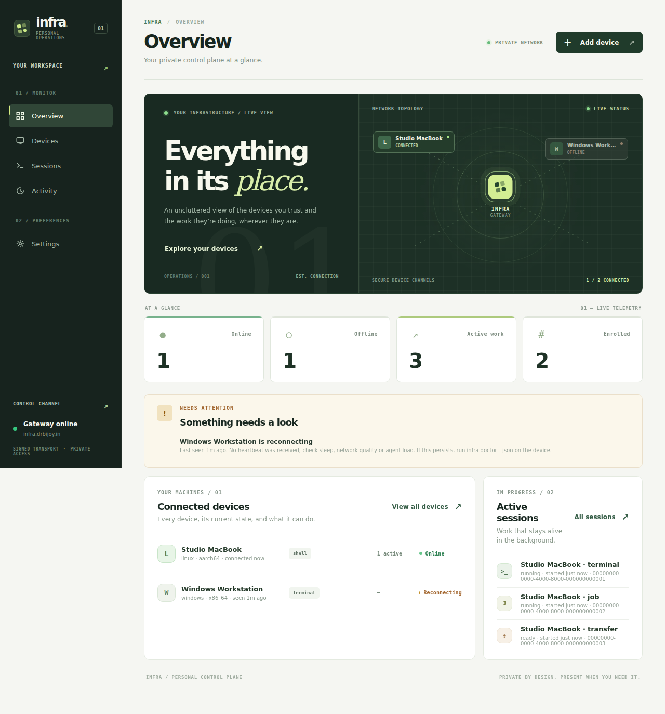
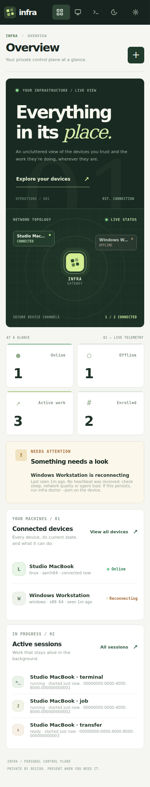
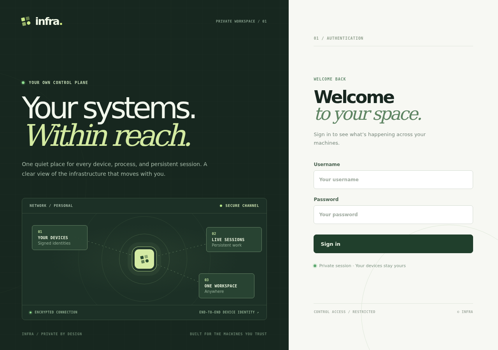

# Infra Fieldwork — visual redesign

**Status:** Implemented on the feature branch for review, not deployed to the public gateway.

The previous generic SaaS card stack is replaced with a **personal operations workspace**. The visual language is quiet, technical and tactile: forest/charcoal navigation, warm mineral surfaces, citron connection signals, editorial typography and fine-lined network geometry.

## Desktop overview

## Mobile overview

## Authentication

## Interaction and information design

- **Real device topology:** Up to four signed devices with online/offline state and the exact fleet-wide connected count. A topology item opens the corresponding device by stable ID; no fabricated telemetry.
- **Overview hierarchy:** Operations hero → four live measures → offline attention → device inventory → persistent sessions.
- **Inventory discovery:** Name/platform/architecture/capability search, slash shortcut outside editable or terminal contexts, no-match state.
- **Control surfaces:** Consistent form states and touch targets, compact responsive navigation, durable sessions, terminal and file workspaces, device status and account security.
- **Pairing:** Authenticated owner approval, local comparison code and legacy enrollment retained.
- **Security:** Escaped server-provided labels, no third-party font/script/image CDNs, no new permissions or APIs, and the existing browser CSP retained.
- **Responsive:** Browser regressions at 320, 390, 768 and 1280 pixels, system dark-mode preference, motion reduction, navigation, terminal I/O, sessions, file previews, hostile device names, and sign-out clearing.
- **No backend stack change:** The Rust gateway still embeds apps/dashboard/index.html, app.js and styles.css through its existing same-origin frontend routes.

Preview screenshots use fictional devices and sessions, not production data.

## Deployment boundary

The live infra.drbijoy.in gateway runs a separate older binary. Publishing the native agent release or pushing GitHub does not deploy the dashboard; the dashboard is compiled into the gateway. A rollout must reconcile the original worktree's uncommitted OAuth changes, validate the live authentication/DB migration, public WSS ingress and rollback, and avoid disconnecting existing enrolled agents. This preview is not a claim that production was updated.
