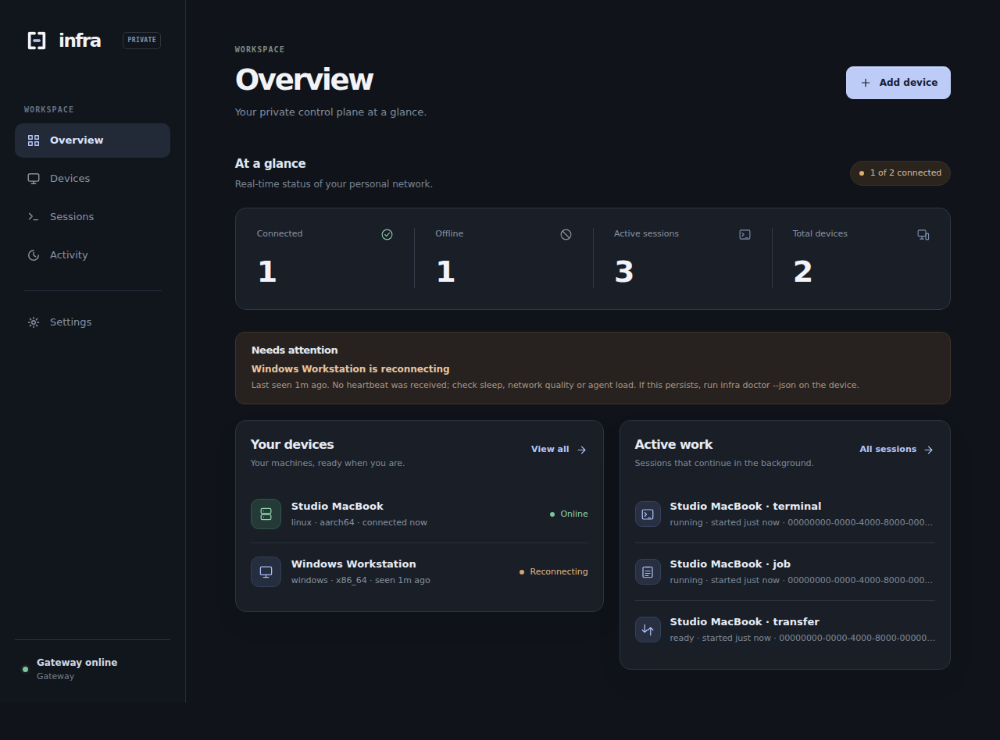
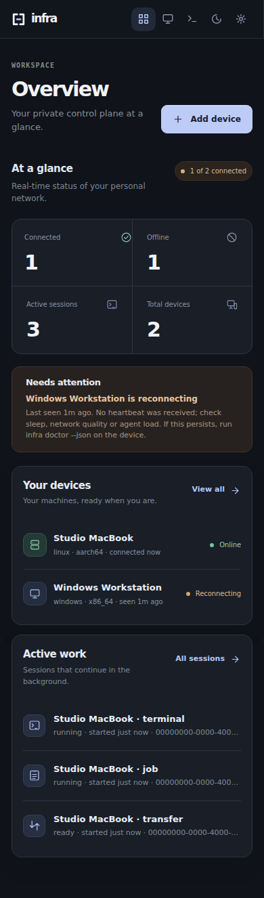
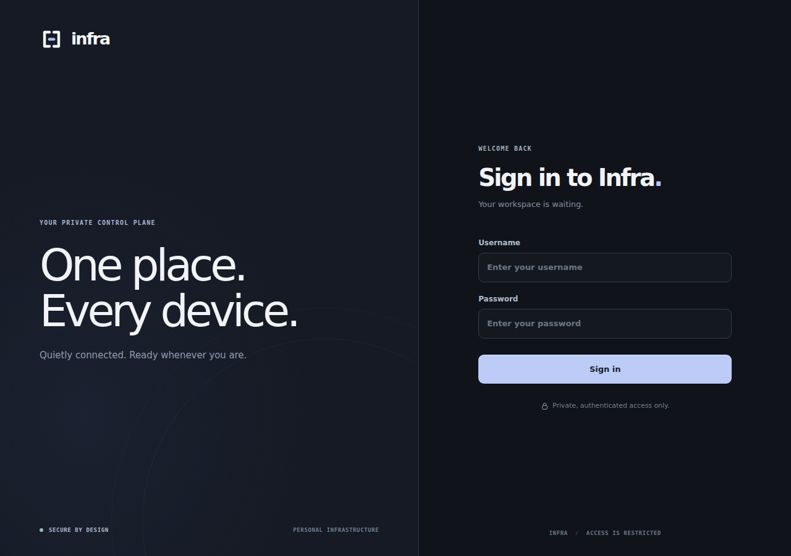
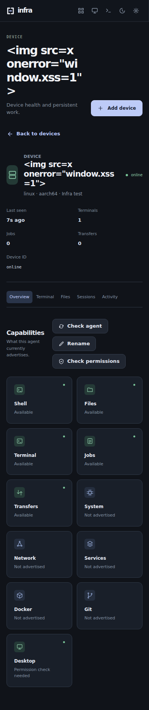

# Infra Studio — identity and dashboard redesign

**Status (2026-10-24):** Deployed successfully to https://infra.drbijoy.in, merged with the current installer fixes, and confirmed through public HTTPS and signed-device reconnection checks.

## Creative direction

Inspired by the design *principles* found in these Dribbble works, without using or copying their design assets:

- [Minimal SaaS Dashboard — Bea Grey](https://dribbble.com/shots/26989557-Minimal-SaaS-Dashboard-Clean-UI-Visual-Hierarchy): space, readable type, deliberate contrast.
- [Sleek & Intuitive SaaS Dashboard — Azaz](https://dribbble.com/shots/25793491-Sleek-Intuitive-SaaS-Dashboard-UI): disciplined navigation and consistently treated interactions.
- [FutureTech Monogram — Nixzora](https://dribbble.com/shots/27181569-FutureTech-Monogram-Logo-Minimal-SaaS-Brand-Identity): scalable geometric identity.
- [Nyerver Server Monitoring — One Week Wonders](https://dribbble.com/shots/9873683-Nyerver-Server-Monitoring-Dashboard): purposeful device-management surfaces, adapted without gratuitous charts.

The visual system has been rebuilt in graphite and muted periwinkle, with a balanced two-column device/work canvas, spacious four-figure operational summary, responsive compact navigation, and an original geometric bridge logomark.

## New Infra logo

`apps/dashboard/assets/logo.svg` is the vector source. Two architectural rails meet at a pale-blue bridge, representing devices joined through a privately controlled gateway. Matching raster files support the app wordmark, favicon and mobile touch icon. The images and icons are local, not external assets.

## Real browser renders (fixture data)

### Desktop overview

### Mobile overview

### Sign-in

### Mobile device details

## Safety and validation

The backend contract, authenticated owner pairing, terminal attach and remote operations, file browser, persistent sessions, and logout are unchanged. The browser suite verifies these interactions, hostile-name escaping, locally loaded brand image, CSP, and no layout overflow at 320/390/768/1280 px. The Rust gateway tests and strict lint pass. No new network font, JavaScript, dependency or third-party image was introduced.

The source branch was isolated from unrelated, uncommitted installation changes in the original worktree. The live gateway should be updated only after a fresh database snapshot, verified staging against the live schema, inactive remote work, signed agent reconnection acceptance, and rollback preparation.

## Live deployment — October 24, 2026

Deployed the combined Infra Studio and installer-fixes gateway from merge commit `fd91f06` to https://infra.drbijoy.in. The immutable candidate and live deployed gateway SHA-256 is `e59c759dce4a34608007aa3e78f5c1962bdc03ee4bad707319d4634e73303e8a`.

An isolated gateway test on a copied live SQLite database validated HTML/CSS/JS, the actual brand logo and favicons, OAuth metadata, owner authentication, pairing API protection and all three persistent device identities. The first rollout attempt was automatically rolled back when a suspended Mac transfer failed the strict preservation check. Another installer task separately deployed its latest gateway fixes, so Studio was merged with those commits (`ce6e3c3`) rather than overwriting them.

The final guarded rollout staged the combined build, saved a fresh snapshot of production SQLite and prior binary, and verified two of two previously online signed devices reconnected. The Mac was already offline before that restart; its pending, locally stored APK download was not read, completed or cancelled. Public HTTPS returns `200` for the new interface, logo, favicon, mobile touch icon, both installer scripts, and OAuth/session endpoints. Unauthenticated devices and pairing APIs return `401`. SQLite remains healthy at schema version 5 with three enrolled devices. No native device binaries or identities were changed.

Rollback snapshots, detached guardian, candidate hash and deployment audit log:
`~/.local/share/infra-v1-remote-burnin/gateway/staging-infra-studio-20261024/`.

Still open: physical Windows first-install/reboot/rollback validation, authenticated first-install bootstrap trust, and confirming the Mac's offline download once the Mac reconnects. This site rollout is not an automatic native agent upgrade.
